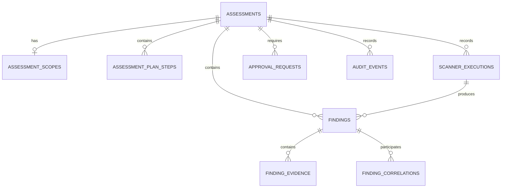

# 10 — Database and Persistence Specification

**Project:** Unified VAPT Agent  
**Document:** Database and Persistence Specification  
**Version:** 1.0  
**Status:** Implementation Reference

---

## 1. Purpose

This document defines the database structure and persistence layer for the Unified VAPT Agent.

The application uses SQLite to store assessment data locally.

The database must support:

- Assessment creation and management.
- Scope information.
- Assessment plans.
- Scanner execution records.
- Raw scanner output.
- Normalized findings.
- Finding evidence.
- Finding correlations.
- Approval decisions.
- Assessment history.
- Report generation.

The database must preserve the distinction between scanner-generated data, application-generated data, and LLM-generated analysis.

---

## 2. Database Technology

**Database:** SQLite

SQLite is selected because:
- The application is a local hackathon MVP.
- The project is primarily single-user.
- It avoids requiring a separate database server.
- It supports relational data and transactions.
- It is straightforward to integrate with Python.

The database must be accessed through a dedicated persistence layer.

The Streamlit UI and LLM must not directly execute database queries.

---

## 3. Database Architecture

The database should contain the following tables:

1. `assessments`
2. `assessment_scopes`
3. `assessment_plan_steps`
4. `scanner_executions`
5. `findings`
6. `finding_evidence`
7. `finding_correlations`
8. `approval_requests`
9. `audit_events`

### Relationships

- An assessment can have one scope record.
- An assessment can have multiple plan steps.
- An assessment can have multiple scanner executions.
- An assessment can have multiple findings.
- A scanner execution can produce multiple findings.
- A finding can have multiple evidence records.
- A correlation can associate multiple findings.
- An assessment can have multiple approval requests.
- An assessment can have multiple audit events.

The database must enforce appropriate foreign-key relationships.

---

## 4. Entity Relationship Overview



The diagram represents the conceptual relationships.

The implementation must use the actual table and column definitions below.

---

## 5. Table: assessments

### Purpose

Stores the main assessment record.

### Fields

| Field | Type | Constraints |
|---|---|---|
| assessment_id | TEXT | Primary key |
| name | TEXT | Required |
| description | TEXT | Optional |
| target | TEXT | Required |
| target_type | TEXT | Required |
| status | TEXT | Required |
| created_at | TEXT | Required |
| updated_at | TEXT | Required |
| completed_at | TEXT | Nullable |
| error_message | TEXT | Nullable |

### Assessment Status

Allowed values:

- Draft
- Scope Validation
- Planning
- Awaiting Approval
- Running
- Analyzing
- Completed
- Failed
- Cancelled

### Rules

- Every assessment must have a unique identifier.
- Target information must be validated before scanner execution.
- Assessment status must be updated through application logic.
- Completed assessments must have a completion timestamp.
- Failed assessments must preserve relevant error information.
- Cancelled assessments must not start new scanner operations.

---

## 6. Table: assessment_scopes

### Purpose

Stores the explicitly authorized scope associated with an assessment.

### Fields

| Field | Type | Constraints |
|---|---|---|
| scope_id | TEXT | Primary key |
| assessment_id | TEXT | Foreign key, unique |
| authorized_targets | TEXT | Required |
| allowed_operations | TEXT | Required |
| restrictions | TEXT | Required |
| validated | INTEGER | Required |
| validated_at | TEXT | Nullable |
| validation_details | TEXT | Nullable |

### Storage

Structured lists may be serialized as JSON text.

The application must validate the JSON structure before storing or using it.

### Rules

- Each assessment must have a scope record before execution.
- Scope must be validated by deterministic application logic.
- The LLM must not directly modify authorization state.
- Scope changes must be recorded in audit history.
- A scope change must invalidate approvals that no longer apply.

The database record does not itself prove authorization.

Authorization must be established and enforced by the application.

---

## 7. Table: assessment_plan_steps

### Purpose

Stores the proposed and executed assessment plan.

### Fields

| Field | Type | Constraints |
|---|---|---|
| step_id | TEXT | Primary key |
| assessment_id | TEXT | Foreign key |
| scanner | TEXT | Required |
| operation | TEXT | Required |
| purpose | TEXT | Required |
| risk_level | TEXT | Required |
| requires_approval | INTEGER | Required |
| status | TEXT | Required |
| execution_id | TEXT | Nullable |
| created_at | TEXT | Required |
| updated_at | TEXT | Required |

### Step Status

Suggested values:

- Pending
- Awaiting Approval
- Approved
- Running
- Completed
- Failed
- Rejected
- Skipped
- Cancelled

### Rules

- Every step must reference an assessment.
- Scanner and operation must exist in the capability registry.
- Execution must not occur before required approval.
- Completed steps must reference their execution record.
- Rejected steps must not execute.
- Step state changes must be recorded.

---

## 8. Table: scanner_executions

### Purpose

Stores scanner execution records.

### Fields

| Field | Type | Constraints |
|---|---|---|
| execution_id | TEXT | Primary key |
| assessment_id | TEXT | Foreign key |
| step_id | TEXT | Foreign key |
| scanner | TEXT | Required |
| operation | TEXT | Required |
| target | TEXT | Required |
| status | TEXT | Required |
| started_at | TEXT | Nullable |
| completed_at | TEXT | Nullable |
| duration_seconds | REAL | Nullable |
| exit_code | INTEGER | Nullable |
| stdout | TEXT | Required |
| stderr | TEXT | Required |
| error_message | TEXT | Nullable |
| parser_status | TEXT | Required |

### Execution Status

- Pending
- Running
- Completed
- Failed
- Timed Out
- Cancelled
- Partial

### Parser Status

- Pending
- Parsed
- Parse Failed
- No Findings
- Not Applicable

### Rules

- Each execution must reference an assessment.
- Each execution must identify its scanner and operation.
- Raw output must be preserved.
- Failed executions must retain diagnostic information.
- Partial results must not be represented as fully completed results.
- Execution status must be updated through application logic.

---

## 9. Table: findings

### Purpose

Stores normalized scanner findings.

### Fields

| Field | Type | Constraints |
|---|---|---|
| finding_id | TEXT | Primary key |
| assessment_id | TEXT | Foreign key |
| execution_id | TEXT | Foreign key, nullable |
| scanner | TEXT | Required |
| scanner_finding_id | TEXT | Nullable |
| title | TEXT | Required |
| description | TEXT | Required |
| target | TEXT | Required |
| affected_url | TEXT | Nullable |
| affected_service | TEXT | Nullable |
| severity | TEXT | Nullable |
| original_severity | TEXT | Nullable |
| severity_source | TEXT | Nullable |
| agent_priority | TEXT | Nullable |
| confidence | TEXT | Nullable |
| verification_status | TEXT | Required |
| cve_id | TEXT | Nullable |
| cvss_score | REAL | Nullable |
| cvss_version | TEXT | Nullable |
| remediation | TEXT | Nullable |
| remediation_source | TEXT | Nullable |
| status | TEXT | Required |
| detected_at | TEXT | Required |
| last_seen_at | TEXT | Nullable |

### Rules

- Every finding must belong to an assessment.
- Scanner attribution must be preserved.
- Severity must remain separate from agent priority.
- Verification status must remain separate from lifecycle status.
- CVE and CVSS values must not be fabricated.
- Findings must retain their source execution when available.
- Finding updates must preserve history.

### Verification Status

- Potential
- Unverified
- Confirmed
- False Positive
- Not Tested

### Lifecycle Status

- Open
- In Review
- Accepted Risk
- Remediated
- Closed

---

## 10. Table: finding_evidence

### Purpose

Stores evidence associated with normalized findings.

### Fields

| Field | Type | Constraints |
|---|---|---|
| evidence_id | TEXT | Primary key |
| finding_id | TEXT | Foreign key |
| evidence_type | TEXT | Required |
| source | TEXT | Required |
| content | TEXT | Required |
| raw_output_reference | TEXT | Nullable |
| collected_at | TEXT | Required |

### Rules

- Evidence must reference a finding.
- Evidence source must be preserved.
- Evidence must not be fabricated.
- Evidence must remain distinguishable from AI-generated explanation.
- Large outputs should use references rather than unnecessary duplication.

The application must preserve evidence when findings are correlated.

---

## 11. Table: finding_correlations

### Purpose

Stores relationships between findings that appear related.

### Fields

| Field | Type | Constraints |
|---|---|---|
| correlation_id | TEXT | Primary key |
| assessment_id | TEXT | Foreign key |
| finding_ids | TEXT | Required |
| correlation_reason | TEXT | Required |
| correlation_method | TEXT | Required |
| created_at | TEXT | Required |

### Storage

`finding_ids` may be stored as JSON text.

The application must validate that:
- The JSON is valid.
- Each referenced finding exists.
- Findings belong to the appropriate assessment.
- The correlation contains valid finding identifiers.

### Rules

- Correlation must not delete original findings.
- Original scanner attribution must remain intact.
- Correlation reasoning must be recorded.
- AI-recommended correlations must be distinguishable from deterministic correlations.

---

## 12. Table: approval_requests

### Purpose

Stores human approval requests for operations requiring approval.

### Fields

| Field | Type | Constraints |
|---|---|---|
| approval_id | TEXT | Primary key |
| assessment_id | TEXT | Foreign key |
| step_id | TEXT | Foreign key |
| operation | TEXT | Required |
| target | TEXT | Required |
| reason | TEXT | Required |
| status | TEXT | Required |
| requested_at | TEXT | Required |
| decided_at | TEXT | Nullable |
| decision_reason | TEXT | Nullable |

### Approval Status

- Pending
- Approved
- Rejected
- Expired
- Invalidated

### Rules

- Approval must reference an assessment and plan step.
- Approval must apply to a specific operation and target.
- Approval must not authorize unrelated operations.
- Scope changes must invalidate affected approvals.
- The LLM must not directly update approval status.
- Execution must revalidate scope and operation policy.

---

## 13. Table: audit_events

### Purpose

Stores the assessment history.

### Fields

| Field | Type | Constraints |
|---|---|---|
| event_id | TEXT | Primary key |
| assessment_id | TEXT | Foreign key |
| event_type | TEXT | Required |
| actor_type | TEXT | Required |
| actor_id | TEXT | Nullable |
| related_entity_type | TEXT | Nullable |
| related_entity_id | TEXT | Nullable |
| details | TEXT | Required |
| created_at | TEXT | Required |

### Actor Types

Suggested values:

- User
- Agent
- Application
- Scanner
- System

### Event Types

Examples:

- Assessment Created
- Scope Validated
- Scope Rejected
- Plan Created
- Approval Requested
- Approval Granted
- Approval Rejected
- Scanner Started
- Scanner Completed
- Scanner Failed
- Finding Created
- Finding Updated
- Finding Correlated
- Report Generated
- Assessment Completed
- Assessment Failed
- Assessment Cancelled

### Rules

- Important assessment actions must be recorded.
- Events must reference the assessment.
- Event details must be structured where practical.
- Audit history must distinguish user actions from agent recommendations.
- Audit events must not be silently rewritten by the LLM.

---

## 14. Foreign Keys and Integrity

The database must enable foreign-key enforcement.

Every table relationship must be validated.

The application must prevent:
- Findings referencing nonexistent assessments.
- Evidence referencing nonexistent findings.
- Plan steps referencing nonexistent assessments.
- Scanner executions referencing nonexistent plan steps.
- Approvals referencing nonexistent plan steps.
- Correlations referencing invalid findings.

Database integrity must be enforced through foreign keys and application validation.

---

## 15. Indexes

The application should create indexes for common queries.

Suggested indexes:

- `assessments.created_at`
- `assessments.status`
- `assessment_plan_steps.assessment_id`
- `scanner_executions.assessment_id`
- `scanner_executions.status`
- `findings.assessment_id`
- `findings.scanner`
- `findings.severity`
- `findings.verification_status`
- `findings.status`
- `finding_evidence.finding_id`
- `approval_requests.assessment_id`
- `approval_requests.status`
- `audit_events.assessment_id`
- `audit_events.created_at`

Indexes should be added only where they improve actual query performance.

---

## 16. Persistence Layer

The application must use a dedicated persistence layer.

Suggested responsibilities:

- Database initialization.
- Connection management.
- Transaction management.
- Assessment CRUD operations.
- Scope persistence.
- Plan persistence.
- Scanner execution persistence.
- Finding persistence.
- Evidence persistence.
- Approval persistence.
- Audit event persistence.

The UI, scanner adapters, and LLM must not independently manage SQL statements.

### Suggested Structure

```text
database/
    connection.py
    initialization.py
    repositories/
        assessment_repository.py
        scope_repository.py
        plan_repository.py
        execution_repository.py
        finding_repository.py
        approval_repository.py
        audit_repository.py
```

This is a suggested structure.

The implementation may use a simpler arrangement if it maintains clear separation of responsibilities.

---

## 17. Transaction Handling

Database writes that belong to a single logical operation must use transactions.

Examples:

### Finding Persistence

When storing a finding:
1. Insert the finding.
2. Insert its evidence.
3. Record the finding creation event.
4. Commit the transaction.

If the operation fails, the application must avoid leaving an inconsistent partial record.

### Approval Decision

When recording an approval:
1. Validate the approval request.
2. Update the approval status.
3. Update the associated plan step.
4. Record the approval event.
5. Commit the transaction.

The application must not execute the scanner as part of an uncommitted approval transaction.

Execution should occur only after the approval decision has been persisted and revalidated.

---

## 18. Database Initialization

The application must initialize the database before accessing assessment records.

Initialization should:
- Create the database file if needed.
- Create required tables.
- Create indexes.
- Enable foreign-key enforcement.
- Validate schema compatibility.

The application must not delete existing assessment records during normal startup.

Schema changes must be handled through explicit migrations.

---

## 19. Schema Versioning

The application should maintain a schema version.

Suggested table:

`schema_version`

Fields:
- version
- applied_at

The application must:
- Detect the current schema version.
- Apply required migrations.
- Preserve existing data.
- Fail clearly if migration cannot be completed.

For the MVP, a simple versioned migration mechanism is sufficient.

---

## 20. Data Retention

The application must preserve assessment records needed for:
- Reviewing findings.
- Reproducing reports.
- Understanding scanner failures.
- Auditing decisions.

Raw scanner output may contain sensitive assessment information.

The application should:
- Store data locally.
- Avoid unnecessary external transmission.
- Avoid logging secrets.
- Avoid storing API keys in the database.
- Avoid retaining unrelated data.

The MVP does not require a complex retention management system.

---

## 21. Database Security

The application must:

- Keep the database in the application's configured data directory.
- Avoid exposing database contents through arbitrary user input.
- Use parameterized database queries.
- Validate values before persistence.
- Avoid storing API keys in assessment records.
- Treat scanner output as untrusted content.
- Prevent the LLM from directly executing SQL.

The database is a persistence mechanism, not an authorization boundary.

Scope enforcement and approval enforcement must remain in application logic.

---

## 22. Report Data Retrieval

Reports must be generated from persisted assessment data.

The report retrieval process should collect:

- Assessment details.
- Scope.
- Plan steps.
- Scanner execution records.
- Findings.
- Evidence.
- Correlations.
- Approval outcomes.
- Assessment history.

The report generator must not rely solely on the LLM conversation history.

The database must remain the source of truth for assessment results.

---

## 23. MVP Acceptance Criteria

The database and persistence layer are acceptable when:

1. SQLite initializes successfully.
2. Assessments can be created and retrieved.
3. Scope records can be persisted.
4. Assessment plans can be stored.
5. Scanner executions can be recorded.
6. Raw scanner output is preserved.
7. Findings can be normalized and persisted.
8. Evidence is associated with findings.
9. Correlations preserve original findings.
10. Approval decisions are persisted.
11. Audit events are recorded.
12. Foreign-key integrity is enforced.
13. Database transactions protect related writes.
14. Existing assessment data survives application restart.
15. Reports can be generated from persisted data.

---

## 24. Final Design Principle

The database must preserve the complete chain:

**Assessment → Authorized Scope → Plan → Approval → Scanner Execution → Evidence → Finding → Analysis → Report**

Every important result must remain traceable to its source.

The database is the source of truth for assessment history and findings.

The LLM is an analysis component, not the database authority.