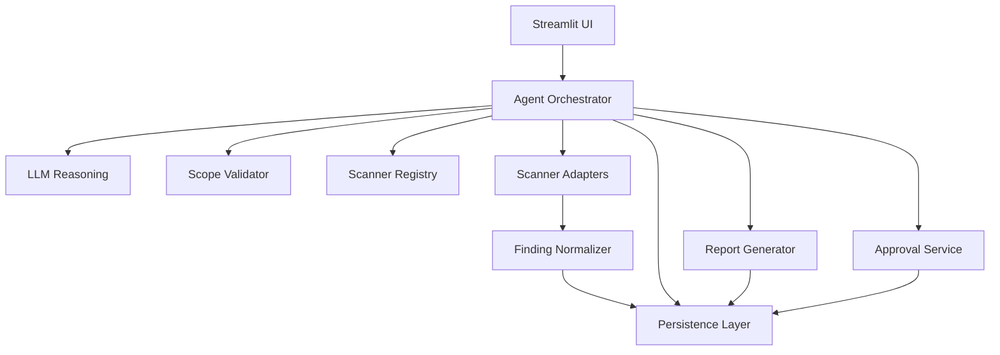

# 11 — API and Tool Contracts

**Project:** Unified VAPT Agent  
**Document:** API and Tool Contracts  
**Version:** 1.0  
**Status:** Implementation Reference

---

## 1. Purpose

This document defines the internal interfaces between the application's major components.

The Unified VAPT Agent consists of:

- Streamlit UI.
- Agent orchestration layer.
- LLM reasoning layer.
- Scope validation service.
- Scanner capability registry.
- Scanner adapters.
- Approval service.
- Finding normalization service.
- Persistence layer.
- Report generation service.

Each component must communicate through defined interfaces.

The purpose is to:
- Prevent components from accessing each other's internal implementation unnecessarily.
- Ensure scanner operations are validated.
- Keep execution separate from LLM reasoning.
- Make the application easier to test.
- Maintain consistent data structures.

This document defines internal Python contracts, not a public REST API.

---

## 2. Architecture



The architecture must maintain the separation between reasoning, validation, execution, and persistence.

---

## 3. General Contract Rules

All internal interfaces must follow these rules.

### 3.1 Explicit Inputs

Every function must receive the information it requires through explicit arguments.

Components must not rely on hidden global state for assessment information.

### 3.2 Structured Outputs

Functions must return structured data rather than ambiguous free-form strings.

Use:
- Dataclasses.
- Typed models.
- Enums.
- Dictionaries only where appropriate.

### 3.3 Validation

Every component must validate its inputs before performing its responsibility.

Validation must not be delegated exclusively to the LLM.

### 3.4 Error Handling

Expected failures must be represented through structured results or application exceptions.

The UI must not display raw internal exceptions as normal assessment results.

### 3.5 Persistence

Components must use the persistence layer for database access.

The LLM, UI, and scanner adapters must not directly execute SQL.

### 3.6 No Arbitrary Execution

The agent must not produce unrestricted executable commands.

Scanner execution must use registered operations and validated arguments.

---

## 4. Shared Data Contracts

The application should define shared models for the following objects:

- Assessment.
- Assessment scope.
- Assessment plan.
- Plan step.
- Scanner operation.
- Scanner execution result.
- Normalized finding.
- Finding evidence.
- Approval request.
- Audit event.
- Report.

These models must remain consistent with the database and scanner integration specifications.

### Suggested Structure

```text
models/
    assessment.py
    scope.py
    plan.py
    scanner.py
    finding.py
    evidence.py
    approval.py
    audit.py
    report.py
```

The implementation may use Pydantic, dataclasses, or another consistent Python modeling approach.

The MVP should use one approach rather than mixing several modeling systems unnecessarily.

---

## 5. Assessment Service Contract

### Responsibility

The assessment service manages assessment creation, retrieval, status changes, and cancellation.

### Required Operations

```python
create_assessment(...)
get_assessment(...)
list_assessments(...)
update_assessment_status(...)
cancel_assessment(...)
```

### Contract

The assessment service must:

- Generate assessment identifiers.
- Validate required assessment information.
- Persist assessment records.
- Enforce allowed state transitions.
- Record important state changes.
- Prevent cancelled assessments from starting new operations.

### Restrictions

The assessment service must not:
- Execute scanners directly.
- Let the LLM modify assessment state.
- Mark an assessment completed when required operations remain unresolved.

---

## 6. Scope Validation Contract

### Responsibility

The scope validation service determines whether a requested target and operation are permitted within the assessment's explicit scope.

### Required Operation

```python
validate_scope(...)
```

### Inputs

The validation operation should receive:

- Assessment identifier.
- Requested target.
- Requested operation.
- Assessment scope.
- Applicable restrictions.

### Output

The validation result must include:

- Valid or invalid status.
- Validated target.
- Validation reason.
- Relevant restrictions.
- Error information, when applicable.

### Contract

The service must:

- Validate the target.
- Validate the operation.
- Reject unauthorized targets.
- Reject unauthorized scope expansion.
- Return a structured result.
- Record important validation outcomes.

### Restrictions

The service must not:
- Treat LLM reasoning as authorization.
- Automatically authorize discovered targets.
- Allow an invalid target to proceed to scanner execution.

---

## 7. Scanner Registry Contract

### Responsibility

The scanner registry exposes scanner capabilities available to the application.

### Required Operations

```python
list_scanners(...)
get_scanner(...)
list_operations(...)
get_operation(...)
```

### Scanner Capability Model

A scanner operation should contain:

- Scanner identifier.
- Operation identifier.
- Description.
- Supported target types.
- Input requirements.
- Risk classification.
- Approval requirement.
- Availability status.

### Contract

The registry must:

- Return only configured scanner operations.
- Validate scanner identifiers.
- Validate operation identifiers.
- Identify unavailable scanners.
- Expose operation restrictions.

### Restrictions

The registry must not:
- Accept arbitrary scanner names from the LLM.
- Invent unsupported operations.
- Treat scanner installation as proof that an operation is authorized.

---

## 8. Agent Planning Contract

### Responsibility

The agent orchestrator converts an assessment request into a structured plan.

### Required Operation

```python
create_assessment_plan(...)
```

### Inputs

The planning operation should receive:

- Assessment request.
- Validated scope.
- Available scanner capabilities.
- Assessment restrictions.
- Relevant assessment context.

### Output

The output must contain:

- Assessment identifier.
- Plan steps.
- Selected scanner operations.
- Operation purpose.
- Risk classification.
- Approval requirements.
- Expected results.

### Contract

The planning layer must:

- Select only registered operations.
- Use the validated target.
- Respect assessment restrictions.
- Explain scanner selection.
- Return structured plan data.

### Restrictions

The planning layer must not:
- Execute scanner operations.
- Approve operations.
- Expand scope.
- Generate arbitrary shell commands.
- Modify scanner capability definitions.

The application must validate the returned plan before persistence or execution.

---

## 9. Approval Service Contract

### Responsibility

The approval service manages approval-required operations.

### Required Operations

```python
request_approval(...)
get_approval(...)
approve_operation(...)
reject_operation(...)
invalidate_approval(...)
```

### Inputs

Approval operations must receive:

- Assessment identifier.
- Plan step identifier.
- Target.
- Operation.
- Approval decision.
- Decision reason, when applicable.

### Contract

The approval service must:

- Persist approval requests.
- Record approval decisions.
- Validate approval state.
- Associate approval with a specific operation.
- Invalidate approvals when scope or operation details change.
- Record approval events.

### Restrictions

The approval service must not:
- Accept approval from the LLM.
- Treat pending approval as approval.
- Approve unrelated operations.
- Allow execution without revalidation.

The application must verify approval immediately before executing an approval-required operation.

---

## 10. Scanner Adapter Contract

### Responsibility

Scanner adapters execute registered scanner operations and return structured execution results.

### Required Interface

```python
class ScannerAdapter:
    def check_availability(self):
        ...

    def list_operations(self):
        ...

    def validate_operation(self, operation, target, parameters):
        ...

    def execute(self, operation, target, parameters):
        ...
```

This is a conceptual interface.

The actual implementation must use the project's chosen data models.

### Contract

Each adapter must:

- Check scanner availability.
- Expose supported operations.
- Validate operation inputs.
- Execute only registered operations.
- Capture scanner output.
- Capture execution errors.
- Return execution status.
- Preserve raw output.

### Restrictions

The adapter must not:
- Accept arbitrary LLM-generated commands.
- Expand target scope.
- Bypass approval.
- Invent scanner findings.
- Claim completion after execution failure.

---

## 11. Scanner Execution Contract

### Responsibility

The orchestration layer coordinates scanner execution.

### Required Operation

```python
execute_plan_step(...)
```

### Inputs

The execution operation must receive:

- Assessment identifier.
- Plan step identifier.
- Validated target.
- Registered scanner operation.
- Validated parameters.
- Approval information, when required.

### Execution Sequence

1. Retrieve the plan step.
2. Confirm the assessment is not cancelled.
3. Retrieve the validated scope.
4. Validate the target.
5. Validate the scanner operation.
6. Check approval requirements.
7. Validate approval, if required.
8. Create the execution record.
9. Execute through the scanner adapter.
10. Persist the execution result.
11. Parse output.
12. Normalize findings.
13. Persist findings and evidence.
14. Record the execution event.

The application must not skip required checks.

### Restrictions

The LLM must not directly call the scanner adapter with arbitrary arguments.

The orchestrator must validate every execution request.

---

## 12. Finding Normalization Contract

### Responsibility

The finding normalization service converts scanner-specific results into the common finding model.

### Required Operation

```python
normalize_findings(...)
```

### Inputs

The operation must receive:

- Scanner identifier.
- Scanner execution identifier.
- Raw or parsed scanner output.
- Assessment identifier.
- Target.

### Output

The service returns normalized findings.

### Contract

The normalizer must:

- Preserve scanner attribution.
- Preserve original scanner identifiers.
- Preserve available evidence.
- Normalize supported severity labels.
- Preserve missing values.
- Assign application finding identifiers.
- Set an appropriate initial verification status.

### Restrictions

The normalizer must not:
- Invent CVEs.
- Invent CVSS scores.
- Claim verification without evidence.
- Delete original scanner output.
- Replace scanner data with AI-generated claims.

---

## 13. Finding Correlation Contract

### Responsibility

The correlation service identifies potentially related findings.

### Required Operation

```python
correlate_findings(...)
```

### Inputs

The operation should receive:

- Assessment identifier.
- Normalized findings.
- Correlation rules.
- Relevant evidence.

### Output

The service returns correlation suggestions or validated correlation records.

### Contract

The service must:

- Preserve original findings.
- Identify the basis for correlation.
- Record the correlation method.
- Avoid merging unrelated findings.
- Preserve scanner attribution.

### Restrictions

The LLM may recommend a correlation.

The application must validate the relationship before persistence.

Correlation must not remove original findings.

---

## 14. Risk Analysis Contract

### Responsibility

The risk analysis service assigns or recommends finding priority.

### Required Operation

```python
analyze_finding_risk(...)
```

### Inputs

The operation should receive:

- Normalized finding.
- Evidence.
- Scanner severity.
- Verification status.
- Available contextual information.
- Configured priority rules.

### Output

The result should include:

- Recommended priority.
- Priority rationale.
- Relevant evidence.
- Missing information.
- Analysis limitations.

### Contract

The service must:

- Preserve scanner severity.
- Distinguish severity from priority.
- Explain the recommendation.
- Identify uncertainty.
- Use the documented priority policy.

### Restrictions

The service must not:
- Invent CVSS scores.
- Change scanner severity silently.
- Claim exploitability without evidence.
- Treat unverified findings as confirmed.

---

## 15. LLM Service Contract

### Responsibility

The LLM service provides reasoning, explanation, planning, and summarization.

### Required Operations

```python
interpret_request(...)
generate_plan(...)
explain_finding(...)
summarize_assessment(...)
generate_remediation(...)
```

### Contract

The LLM service must:

- Receive only the context needed for the task.
- Return structured output where required.
- Follow the expected schema.
- Identify uncertainty.
- Use provided evidence.
- Avoid unsupported claims.

### Restrictions

The LLM service must not:
- Execute shell commands.
- Access the database directly.
- Change scope authorization.
- Approve scanner operations.
- Directly update assessment state.
- Directly create confirmed findings without evidence.
- Bypass application validation.

### Prompt and Output Validation

Every structured LLM response must be validated.

If validation fails:
- Reject the output.
- Record the failure.
- Retry only within configured limits.
- Do not execute invalid output.

---

## 16. Persistence Contract

### Responsibility

The persistence layer manages database operations.

### Required Operations

```python
save_assessment(...)
get_assessment(...)
save_scope(...)
save_plan(...)
save_execution(...)
save_findings(...)
save_evidence(...)
save_approval(...)
save_audit_event(...)
```

Additional retrieval operations may be implemented as required.

### Contract

The persistence layer must:

- Validate records.
- Use parameterized queries.
- Enforce database relationships.
- Use transactions for related writes.
- Return structured records.
- Record persistence failures.

### Restrictions

The persistence layer must not:
- Accept arbitrary SQL from the LLM.
- Allow unvalidated state transitions.
- Silently discard evidence.
- Hide database failures.

---

## 17. Report Generation Contract

### Responsibility

The report generator creates an assessment report from persisted data.

### Required Operation

```python
generate_report(...)
```

### Inputs

The report generator should receive:

- Assessment identifier.
- Persisted assessment data.
- Scope.
- Scanner execution records.
- Findings.
- Evidence.
- Correlations.
- Approval outcomes.
- Assessment limitations.

### Output

The report generator must return:

- Report content.
- Report format.
- Generation status.
- Assessment identifier.
- Generation timestamp.

### Contract

The report generator must:

- Use persisted assessment records.
- Preserve finding verification states.
- Include relevant evidence.
- Identify failed or incomplete operations.
- Clearly distinguish findings from recommendations.
- Avoid unsupported security claims.

### Restrictions

The report generator must not:
- Invent scanner results.
- Hide failed operations.
- Claim complete coverage without evidence.
- Claim the target is secure.

---

## 18. Streamlit UI Contract

### Responsibility

The UI presents assessment information and collects user decisions.

### Required UI Actions

The UI should support:

- Create assessment.
- Enter target and scope.
- Review assessment plan.
- Approve or reject operations.
- Start permitted assessment operations.
- View scanner execution status.
- View findings.
- Review evidence.
- View assessment history.
- Generate and download reports.

### Contract

The UI must:
- Call application services.
- Display persisted state.
- Display execution status accurately.
- Display approval requirements.
- Display errors clearly.
- Prevent invalid user actions.

### Restrictions

The UI must not:
- Execute scanners directly.
- Modify database records through arbitrary SQL.
- Bypass approval checks.
- Display fabricated assessment progress.

---

## 19. Error Contract

Expected application errors should use structured representations.

Suggested error fields:

```python
class ApplicationError:
    code: str
    message: str
    component: str
    assessment_id: str | None
    operation_id: str | None
    details: dict
```

Suggested error categories:

- ValidationError
- ScopeViolation
- ScannerUnavailable
- OperationNotAllowed
- ApprovalRequired
- ApprovalRejected
- ExecutionFailed
- ExecutionTimeout
- ParsingFailed
- PersistenceFailed
- LLMError
- ReportGenerationFailed

The application must distinguish expected failures from unexpected exceptions.

Unexpected exceptions must be logged and surfaced as application failures rather than normal scanner findings.

---

## 20. Audit Contract

### Responsibility

The audit service records important application actions.

### Required Operation

```python
record_event(...)
```

### Inputs

- Assessment identifier.
- Event type.
- Actor type.
- Related entity.
- Event details.

### Contract

The audit service must:
- Persist important events.
- Preserve timestamps.
- Record actor attribution.
- Associate events with assessments.
- Distinguish user, scanner, application, and agent activity.

Audit recording must not depend on the LLM.

---

## 21. Dependency Direction

Components should depend on interfaces rather than each other's implementation details.

Recommended dependency direction:

- UI → Application Services
- Agent Orchestrator → Application Services
- Application Services → Scanner Registry
- Application Services → Approval Service
- Application Services → Scanner Adapters
- Application Services → Persistence
- Scanner Adapters → Scanner Output Parsers
- Finding Normalizer → Finding Models
- Report Generator → Persistence and Report Models

The scanner adapters must not depend on the Streamlit UI.

The LLM service must not depend on database implementation details.

The database layer must not depend on the LLM.

---

## 22. MVP Implementation Priority

Implement the contracts in this order:

1. Shared data models.
2. Persistence interface.
3. Assessment service.
4. Scope validation service.
5. Scanner registry.
6. Scanner adapter interface.
7. Nmap adapter.
8. Nikto adapter.
9. ZAP adapter.
10. Finding normalization.
11. Approval service.
12. Agent orchestration.
13. LLM service.
14. Report generation.
15. Streamlit integration.

This order establishes the deterministic foundations before adding agent reasoning.

---

## 23. MVP Acceptance Criteria

The API and tool contracts are acceptable when:

1. Components use structured interfaces.
2. Shared models are consistent.
3. Scope validation is deterministic.
4. Scanner operations are registered.
5. Scanner adapters reject invalid operations.
6. Approval checks occur before execution.
7. Scanner results use a common execution model.
8. Findings use the normalized finding model.
9. Persistence is accessed through repositories or services.
10. The LLM cannot directly execute commands or SQL.
11. Errors are represented consistently.
12. Reports use persisted assessment data.
13. Important actions are auditable.
14. Components can be tested independently.

---

## 24. Final Design Principle

The application must maintain this responsibility boundary:

**The LLM reasons. The application validates. The approval service authorizes. The scanner adapter executes. The persistence layer records. The report generator communicates the results.**

No component should bypass another component's security-critical responsibility.